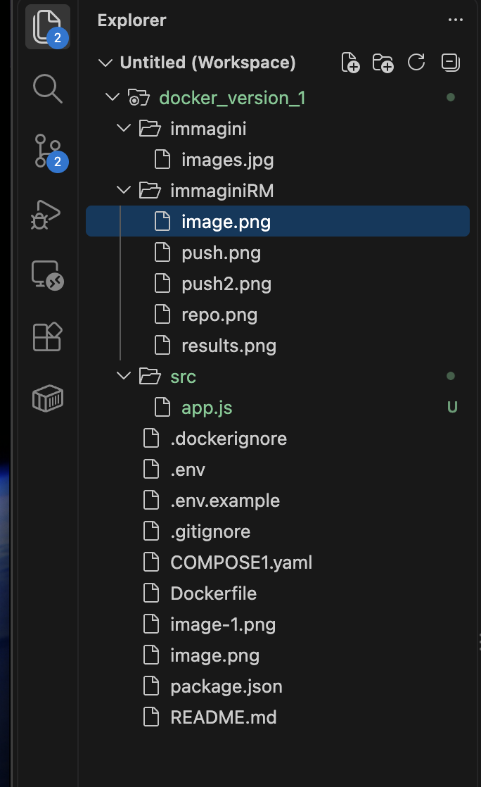
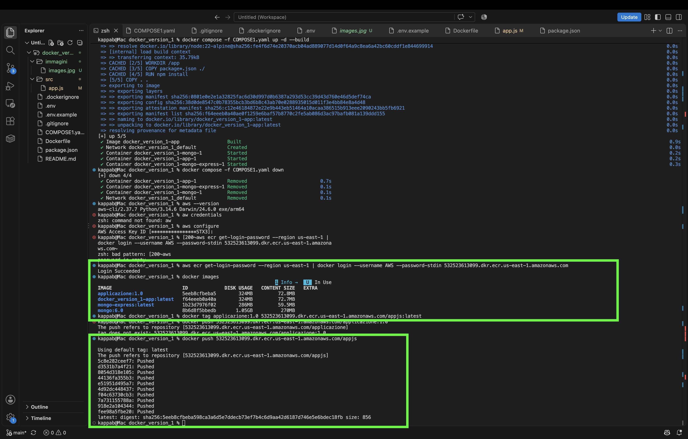
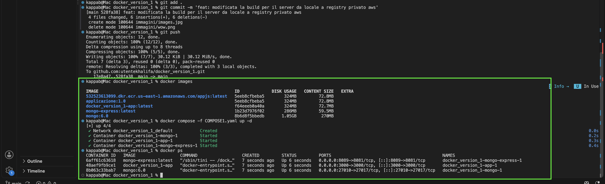
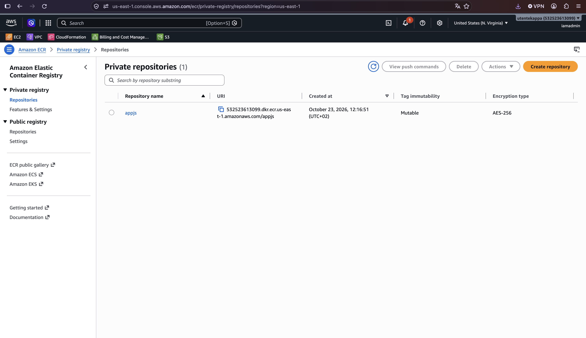
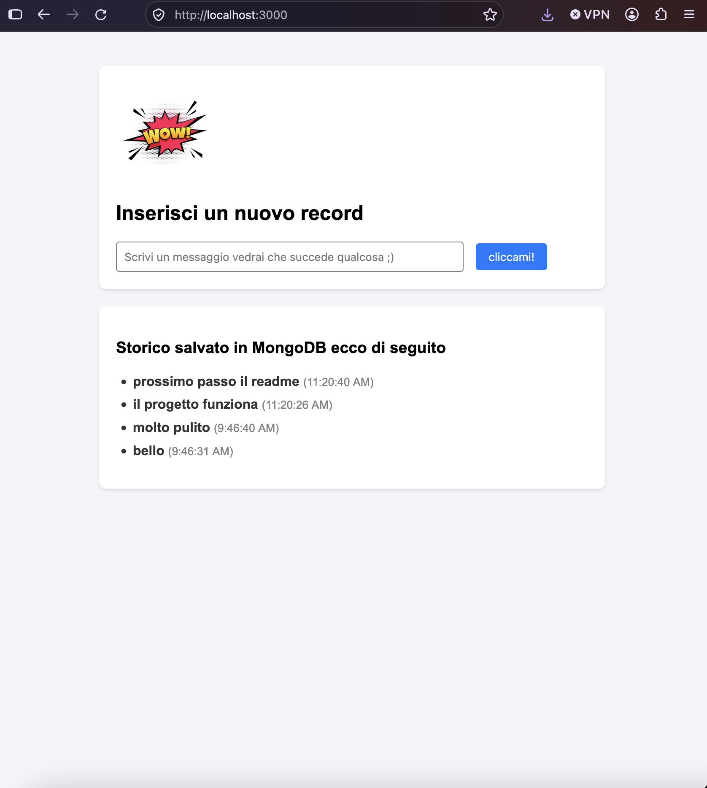

# App container & AWS ECR deployment

Questo rogetto è incentrato sulla containerizzazione tramite Docker e Docker Compose di un'applicazione web (Node.js + MongoDB + MongoExpress), con focus sulla gestione delle configurazioni, sicurezza dei file di ambiente, versionamento e rilascio dell'immagine custom su Amazon ECR.
Architettura del Progetto:
L'applicazione è strutturata in container isolati ma interconnessi tramite una rete Docker dedicata (che viene creata automaticamente con il compose):
* **App (`Node.js`):** Gestisce la logica server (contiene anche la parte HTML), le rotte API REST(`GET` / `POST`) e la comunicazione con il database.
* **Database (`MongoDB`):** Persistenza dei dati (cronologia dei messaggi scritti dalla barra) e utilizzo di volumi per la persistenza data la natura effimera dei container con semplice utilizzo es. nomevolume:/percorso del container.
* **Database Management (`Mongo Express`):** Interfaccia web di amministrazione per il database per un controllo visivo dei dati presenti nelle tabelle.

## SICUREZZA E GESTIONE DELLE CONFIGURAZIONI
Particolare attenzione è stata dedicata alla protezione dei dati sensibili e alla pulizia del repository:
* **File di environment:** Utilizzo di un file `.env` per le credenziali di connessione al database (escluse dal controllo di versione) affiancato da un semplice template `.env.example` .
* **Esclusioni mirate:** Configurazione rigorosa di `.gitignore` e `.dockerignore` per escludere `node_modules/`, file di log e credenziali, preservando README, Dockerfile e configurazioni compose.

## Strategia di Build Locale e Migrazione su AWS ECR

Il flusso di gestione dell'applicazione si articola in due fasi distinte a livello di configurazione Docker Compose:

1. Inizialmente, il servizio dell'applicazione Node.js nel file `COMPOSE1.yaml` è stato configurato per utilizzare il contesto di build locale (`build: .`), consentendo di testare le modifiche al codice e la connessione a MongoDB direttamente sul proprio ambiente di sviluppo.

2. Transizione all'immagine remota su AWS ECR

Una volta validato il comportamento dell'applicazione, l'immagine custom è stata taggata e pubblicata su Amazon ECR. Questa separazione permette di disaccoppiare il codice sorgente dall'esecuzione dell'infrastruttura, consentendo al Compose di attingere direttamente al registro remoto:

    Autenticazione ed esecuzione del push su ECR:
    dopo aver creato la repository da console (consultando la documentazione ufficiale AWS e utilizzo di credenziali per utilizzo della cli locale) creare la repository e caricare l'immagine utilizzando anche i passaggi forniti alla crazione per collegarsi e creare una immagine dedicata.

- Autenticazione del client Docker tramite AWS CLI:
aws ecr get-login-password --region <tua-regione> | docker login --username AWS --password-stdin <account-id>.dkr.ecr.<regione>.amazonaws.com

- Tag dell'immagine locale con l'URI del repository AWS ECR:
docker tag app-locale:latest <account-id>.dkr.ecr.<regione>[.amazonaws.com/tuo-repo:latest](https://.amazonaws.com/tuo-repo:latest)

- Caricamento dell'immagine:
docker push <account-id>.dkr.ecr.<regione>[.amazonaws.com/tuo-repo:latest](https://.amazonaws.com/tuo-repo:latest)

    Aggiornamento del COMPOSE1.yaml per puntare all'URI dell'immagine su ECR anziché al contesto di build locale.

L'infrastruttura separa chiaramente i servizi di base (MongoDB e Mongo Express prelevati dai registry pubblici) dall'applicazione custom Node.js, quest'ultima pubblicata su Amazon ECR sotto forma di repository privato per simulare una immagine creata in ambito aziendale e che quindi non si vuole rendere pubblica.

Con il seguente risultato finale:

